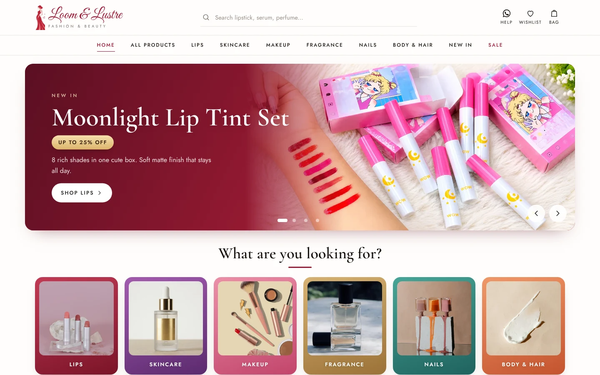
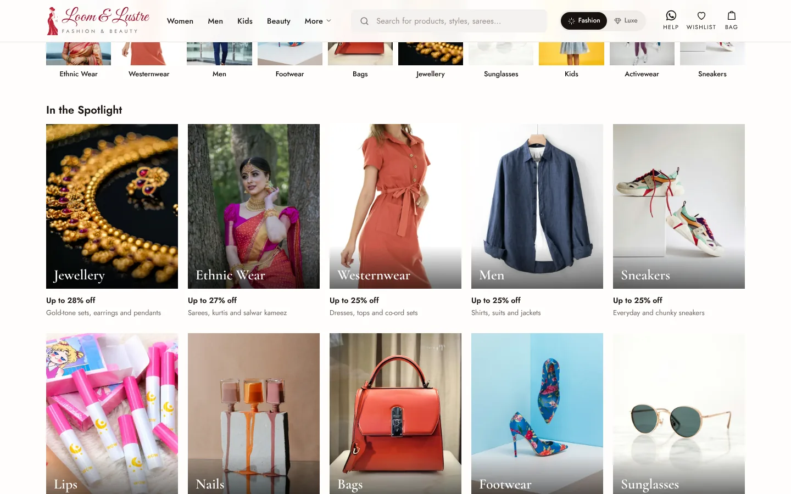
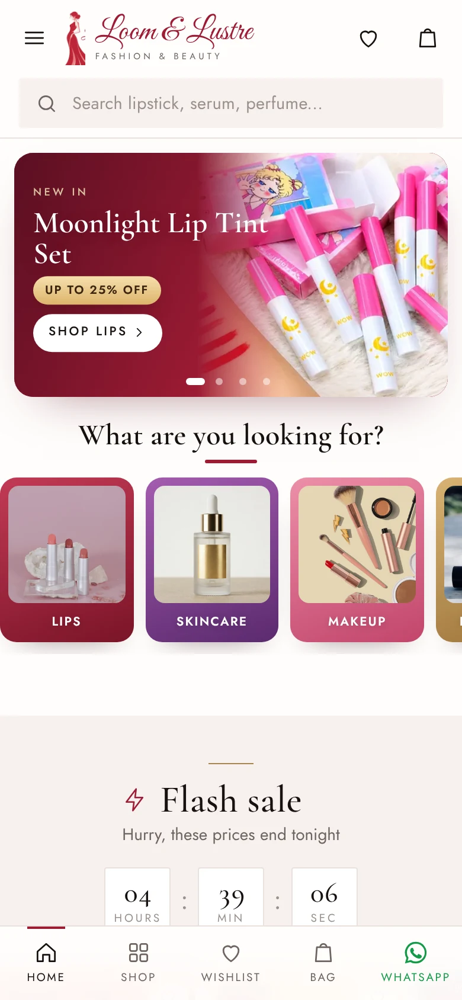
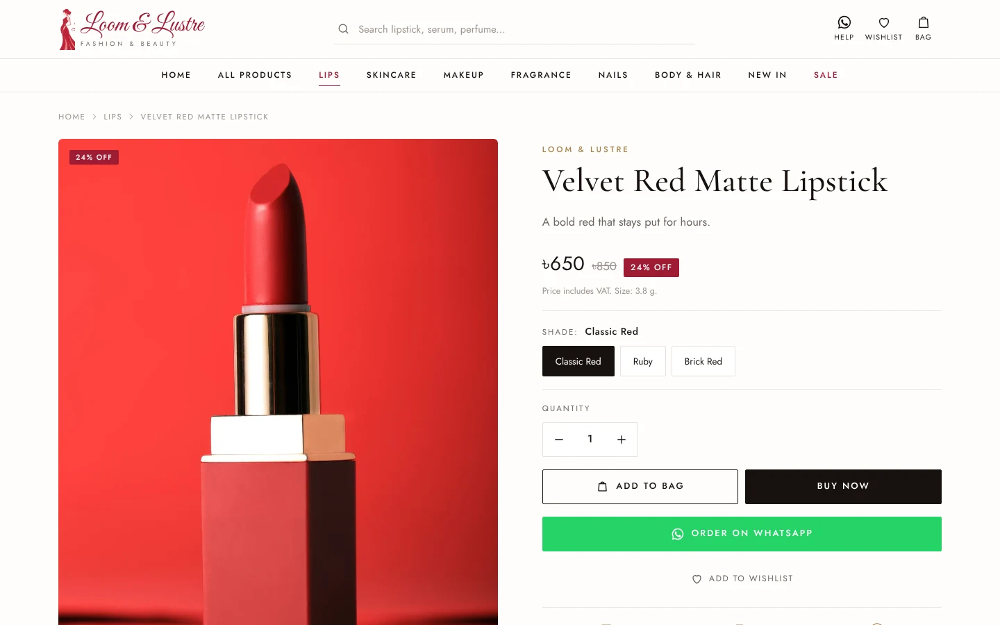
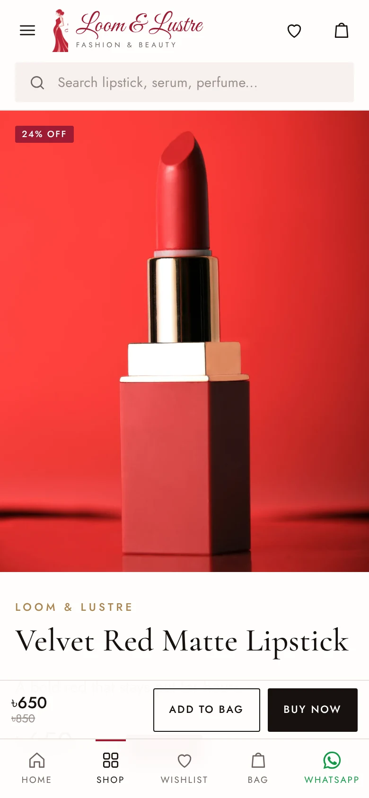
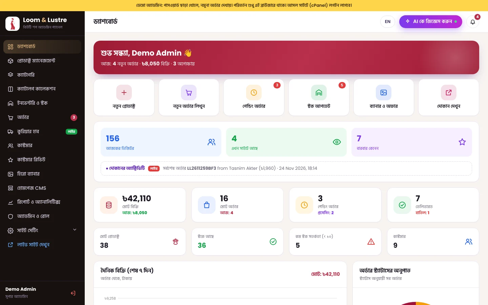
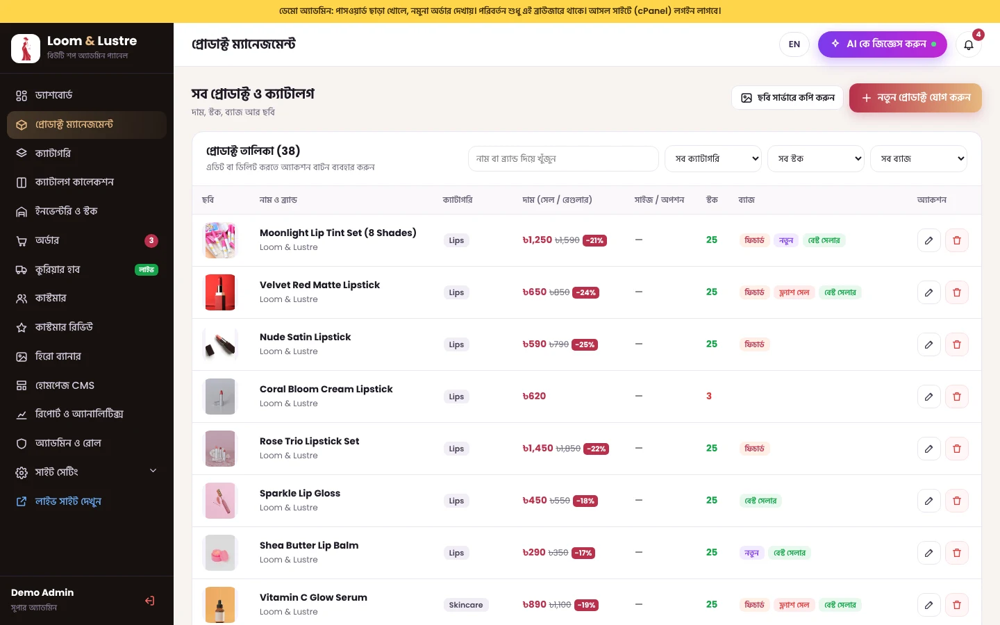

# Loom & Lustre

### Fashion & Beauty online shop for Bangladesh

Sarees and kurtis, westernwear, menswear, footwear, bags, jewellery, sunglasses, kids, activewear and sneakers, plus lipstick, skincare, makeup, fragrance, nails and body care, with cash on delivery all over Bangladesh.

 

---

## Screens

<table>
<tr>
<td width="68%"> Flash sale with countdown, discount badges and shades</td>
<td width="32%"> Home on phone</td>
</tr>
<tr>
<td> Product page: big photo, shade picker, Add to bag, Order on WhatsApp</td>
<td> Product page on phone</td>
</tr>
</table>

### Admin panel (Bangla, with an EN button)

<table>
<tr>
<td> Dashboard: sales, orders, visitors, low stock</td>
<td> Products: search, edit, price and stock</td>
</tr>
</table>

---

## Features

| Shop | Admin |
|---|---|
| Wide auto-sliding offer banner. The "Up to X% off" pill is worked out from real prices | Bangla by default, EN button, the same shared panel as every shop |
| Women, Men, Kids, Beauty menu with a Fashion / Luxe switch; photo category row, In the Spotlight offers, Styles To Celebrate In, Stylists' Picks, Luxe Edit, circles; Categories page and a dark Luxe store | Dashboard with sales chart, live activity and recent orders |
| 18 categories (with Watches and Home) and 112 sample products with colours, shades, sizes and stock | Products: sizes, shades, photo gallery, AI copywriter |
| Product page: shade picker, Add to bag, Buy now, Order on WhatsApp | Categories, collections, inventory and stock |
| Bag, wishlist, checkout with cash on delivery | Orders: status tabs, manual orders, invoice, CSV, courier (Steadfast) |
| Inside / Outside Dhaka delivery charge, optional bKash and Nagad | Reviews, hero banners, homepage sections on/off |
| Order tracking by order number and phone | Admins and roles (Super Admin, Manager, Staff) |
| Search, sort and price filter | Settings: store, delivery, payment, SMS, Meta Pixel + CAPI, SEO |
| Phone layout with a bottom tab bar and smooth entrance animation | Phone layout with an app-style bottom bar |
| SEO: sitemap, robots, canonical, Open Graph, Product structured data | Login lock after wrong passwords, show/hide password |

## Tech

- **PHP 8.1+ and SQLite.** No MySQL, no Node.js, no build step.
- The database creates itself on the first visit, in `~/loomlustre-data` outside the public folder when the host allows it.
- Fonts: Cormorant Garamond and Jost. Photos are sharp 4:5 WebP (1200 px, with 600 px phone copies).
- `docs/` is a static copy for GitHub Pages, built with `php tools/build-demo.php /Loom-Lustre/`. Pages has no PHP, so the admin there runs in demo mode with sample data, and changes stay in your browser only.

## Set up on your own hosting

1. Upload all files (everything except `docs/`) to `public_html` on any cPanel host with PHP 8.1 or newer.
2. Open `yourdomain.com/admin`. The first visit asks you to create the admin username and password.
3. Go to **সাইট সেটিং** (Site settings) and add the shop phone, WhatsApp, Facebook link and delivery charges.
4. Replace the sample products with your own from **প্রোডাক্ট ম্যানেজমেন্ট** (Products).

**Forgot the admin login?** Upload an empty file named `reset-admin.txt` to `public_html`, then open `/admin` and set a new username and password. The file deletes itself.

## Credits

Product photos are from [Unsplash](https://unsplash.com) (free to use). Replace them with real product photos from the admin panel.

Designed and developed by **Abid Islam** and **[Boostnix Media](https://boostnixmedia.com)**

